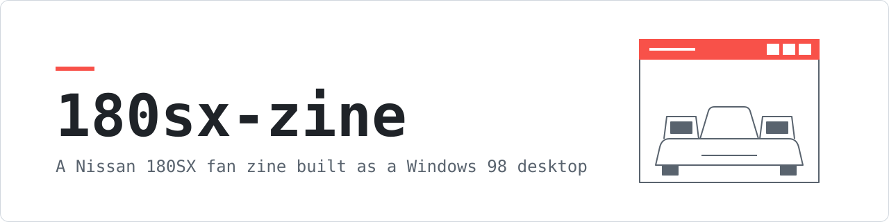
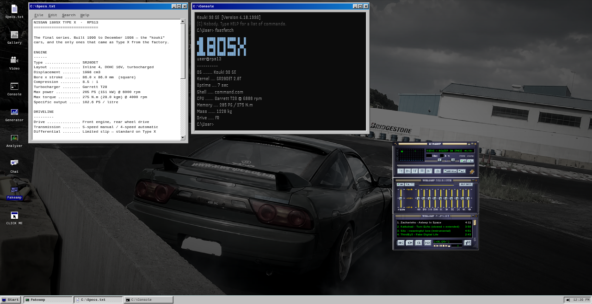
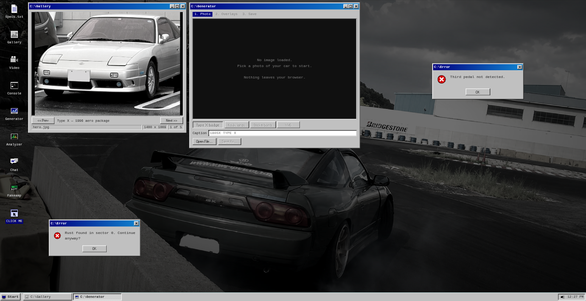

<div align="center">

<picture>
  <source media="(prefers-color-scheme: dark)" srcset="docs/assets/banner-dark.svg">
  
</picture>

# 180sx-zine

### A Nissan 180SX fan zine built as a Windows 98 desktop

**There are no pages: you land on a desktop, open windows and poke at a spec sheet, a gallery, a Winamp, a console and a live chat.**

[](LICENSE)
[](https://github.com/minomat180/180sx-zine/actions/workflows/deploy.yml)
[](https://180sx.tech)
[](https://react.dev)
[](https://vite.dev)
[](https://pages.cloudflare.com)

[**Live site**](https://180sx.tech) · [On the desktop](#on-the-desktop) · [Quick start](#quick-start) · [How it works](#how-it-works) · [Deploy](#deploy) · [Credits](#credits)

<code>npm ci && npm run dev</code>

<br>



<sub>The live site: Specs.txt, the console after <code>fastfetch</code>, and Fakeamp.</sub>

</div>

---

An enthusiast zine about the Nissan 180SX Type X, the last 180SX series (1996
to 1998). It starts with a BIOS POST screen, the wallpaper glitches every so
often, and Start > Shut Down ends on "It's now safe to turn off your computer".

- **A window manager in about 200 lines.** `src/os/windowStore.js` holds all
  window state (open windows, positions, z-order, minimised and maximised) in a
  plain module-level store read with `useSyncExternalStore`. There is no state
  library, no router and no context provider.
- **Winamp lives outside React.** [Webamp](https://webamp.org) draws its own
  chrome and appends itself to `document.body`, and unmounting it stops
  playback, so `Fakeamp.jsx` creates it once and afterwards only hides it. It
  is about 900 kB minified and only loads when someone opens the player.
- **A spectrum analyzer on the player's audio graph.** The Analyzer window
  draws spectrum, oscilloscope and radial views from Webamp's analyser node,
  and `src/os/ampBridge.js` tells it when the player appears, because the
  player may not exist yet when the Analyzer opens.
- **Chat on one Durable Object.** A Pages Function hands the WebSocket to a
  Durable Object in a separate Worker. The room keeps up to 60 messages in
  memory and writes nothing to storage.
- **Sounds and images made in the browser.** UI sounds are synthesised with the
  Web Audio API in `src/audio.js`, and the Generator composites your photo
  with Canvas 2D without uploading it anywhere.

## On the desktop

| Icon | What it does |
| --- | --- |
| Specs.txt | Notepad with the Type X spec sheet |
| Gallery | Image viewer that pages through the photos |
| Video | A Win98 frame around a self-hosted drift clip |
| Console | A small shell: `help`, `dir`, `open gallery`, `play`, `fastfetch`, `whoami`, `drift`, `cls` |
| Generator | Load your own photo, stack overlays and a caption on it, save the result |
| Fakeamp | Webamp, a Winamp 2 clone, with the zine's playlist |
| Analyzer | Spectrum, oscilloscope and radial views of whatever Fakeamp is playing |
| Chat | One shared room for everyone currently on the site |
| CLICK ME | An error dialog. Every OK spawns two more, until it blue-screens |

<div align="center">


<sub>Gallery, Generator and the first error dialogs from CLICK ME.</sub>
</div>

Below 768 px wide, windows open maximised and dragging is off.

## Quick start

Needs Node 20.19+ or 22.12+ (CI uses 24).

| Command | What it does |
| --- | --- |
| `npm ci` | Install dependencies |
| `npm run media` | Fetch photos, music and video into `public/media/` (needs access, see below) |
| `npm run dev` | Vite dev server |
| `npm run lint` | oxlint |
| `npm run build` | Production build into `dist/` |

> [!NOTE]
> The media files are not in this repository. Most of them belong to other
> people, so they live in a private repo, `minomat180/180sx-media`.
> `npm run media` clones it into `.media/` and copies the folders into
> `public/media/`. Without access the site still builds and runs, with empty
> gallery, player and video windows. Everything that is shown is listed in
> `src/media.js`.

> [!TIP]
> Chat only works on the deployed site. The Vite dev server has no Pages
> Function or Durable Object, and the Chat window says it cannot reach the room.

## How it works

**Windows.** `src/os/windowStore.js` is the only window state.
`src/os/appSpecs.js` holds window metadata and imports no components, so the
taskbar, Start menu and console can list apps without importing every
component, and `App.jsx` alone maps ids to components.

**Fakeamp and the Analyzer.** Webamp is dynamically imported on first open and
never unmounted. The Analyzer subscribes to `src/os/ampBridge.js` and reads the
player's analyser node whenever it exists.

**Chat.** The browser connects to a Cloudflare Pages Function
(`functions/api/chat.js`), which forwards the WebSocket to the `ChatRoom`
Durable Object in `worker/`, because a Pages project can bind to a Durable
Object but cannot define one. History lives in memory only and is gone when the
object hibernates. Idle sockets were being closed by Cloudflare after about two
minutes; the client now pings every 30 seconds and the Durable Object answers
with `setWebSocketAutoResponse`, which does not wake it from hibernation.

**Build.** `vite.config.js` rewrites one malformed media query in 98.css 0.1.21
that otherwise fails the production CSS minifier.

## Deploy

`.github/workflows/deploy.yml` lints and builds every push and pull request,
fetching the media repo with a read-only deploy key first. For pushes it then
uploads `dist/` and `functions/` to the Cloudflare Pages project with
`wrangler pages deploy`: production from `main`, a preview URL for any other
branch. Pull requests are never deployed.

The chat Worker changes rarely and is deployed by hand:

```sh
cd worker && npx wrangler deploy
```

The Pages project binds it as the Durable Object `CHAT` (class `ChatRoom`,
Worker `180sx-chat`), set once in the Cloudflare dashboard.

## Status

Feature work stopped in August 2026. Known gap: the player's title bar still
reads WINAMP, because the text is part of the default skin bitmap. Changing it
needs a custom `.wsz` skin.

## Credits

Built with [React](https://react.dev), [Vite](https://vite.dev),
[98.css](https://jdan.github.io/98.css/) and [Webamp](https://webamp.org)
(all MIT). Fonts: Press Start 2P and Handjet (SIL Open Font License), loaded
from Google Fonts. The desktop-as-website idea and look follow
[fakeverything.com](https://fakeverything.com).

| Media | Source | Licence |
| --- | --- | --- |
| Gallery photos | Tokumeigakarinoaoshima: [front](https://commons.wikimedia.org/wiki/File:Nissan_180SX_TYPE_X_(E-RPS13)_front.jpg), [rear](https://commons.wikimedia.org/wiki/File:Nissan_180SX_TYPE_X_(E-RPS13)_rear.jpg) | CC BY-SA 4.0 |
| | Tokumeigakarinoaoshima: [tuned RPS13](https://commons.wikimedia.org/wiki/File:Tuned_Nissan_180SX_(RPS13)_front.JPG) | CC0 |
| | Toyotacoronaexsaloon: [Type X](https://commons.wikimedia.org/wiki/File:Nissan_180sx_rps13_typex_1_f.jpg) | CC BY-SA 4.0 |
| Drift video | [SR20 180SX Touge Drift](https://www.youtube.com/watch?v=CsaEQvSFEgM) by Jack Atkins | not licensed for reuse |
| Music | Zachariehs, Kaikobad, Silo, ThirdEy3, EXODIA | not licensed for reuse |

The screenshots in `docs/` show some of these.

## License

The code and text are mine, all rights reserved (see [`LICENSE`](LICENSE)).
The media belongs to its creators and is not covered by that license.

> [!IMPORTANT]
> An enthusiast project. Not produced by, endorsed by, or connected with Nissan
> Motor Co., Ltd.
